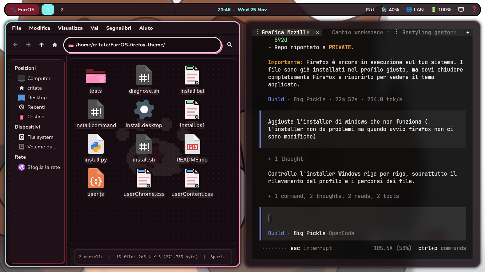

# FurrOS Thunar Theme

Tema GTK3 per **Thunar** che replica il design system di [FurrOS](https://furros.xyz/)
e del tema Firefox FurrOS: palette scura, bordi "sticker", chip arrotondati,
zampina e icone coordinate.



## Contenuto

```
gtk3/                       tema GTK3 (adw-gtk3-dark + override FurrOS)
  gtk-3.0/gtk.css
  gtk-3.0/assets/furros-watermark.png
  index.theme
icons/FurrOS-Papirus/       65 icone SVG (cartelle + tipi di file)
  index.theme               eredita da Papirus-Dark
  generate.py               rigenera le icone
  scalable/places/
  scalable/mimetypes/
config/settings.ini.example valori finali di riferimento
install.sh                  installazione + backup + restart Thunar
uninstall.sh                ripristino ad Adwaita/Papirus-Dark
```

## Installazione

 Su FurrOS/Arch con Thunar 4.20 e `adw-gtk3-dark` installato:

```bash
git clone https://github.com/Critata/FurrOS-thunar-theme.git
cd FurrOS-thunar-theme
chmod +x install.sh uninstall.sh
./install.sh
```

Lo script:

1. copia il tema in `~/.themes/FurrOS`;
2. copia le icone in `~/.local/share/icons/FurrOS-Papirus`;
3. fa un backup di `~/.config/gtk-3.0/settings.ini` e
   `~/.config/gtk-4.0/settings.ini` con suffisso `.bak-DATA-ORA`;
4. aggiorna solo le chiavi necessarie (`gtk-theme-name`,
   `gtk-icon-theme-name`, font Nunito, dark mode), lasciando intatte le altre;
5. applica i valori anche via `gsettings`;
6. riavvia Thunar se era in esecuzione.

Verifica:

```bash
gsettings get org.gnome.desktop.interface gtk-theme
gsettings get org.gnome.desktop.interface icon-theme
# 'FurrOS'
# 'FurrOS-Papirus'
```

## Disinstallazione

```bash
./uninstall.sh
```

Riporta `gtk-theme` ad `Adwaita` e `icon-theme` a `Papirus-Dark` e rimuove
tema e icone. I backup creati da `install.sh` restano nelle rispettive cartelle.

## Palette

| Nome | Colore | Uso |
| --- | --- | --- |
| night | `#150B11` | sfondo finestre e viste |
| plum | `#1E1218` | headerbar, toolbar, sidebar |
| surface | `#2A1A22` | pannelli |
| surface-2 | `#3A2430` | hover, bottoni |
| paper | `#FFECEC` | testo, bordi, selezioni |
| ink | `#0E080B` | ombre, testo su paper |
| cyan | `#7FF0F0` | focus e accento primario |
| pink | `#FF8CBE` | accento secondario |
| red | `#E23A44` | ombre e azioni distruttive |
| maroon | `#781C2C` | hover e retro cartelle |

## Dettagli tecnici

- Il CSS importa `/usr/share/themes/adw-gtk3-dark/gtk-3.0/gtk.css` come base:
  se quel tema non è presente, installa `adw-gtk3-dark` prima di `install.sh`.
- Thunar usa classi interne come `.sidebar`, `.standard-view`,
  `.location-button` e `notebook`: sono quelle che permettono di stilizzare
  pane laterale, area file, breadcrumb e schede senza patchare l'applicazione.
- Le icone sono SVG scalable, quindi funzionano a qualsiasi dimensione;
  `generate.py` non richiede dipendenze oltre a Python 3.
- Il watermark `furros-watermark.png` è ricavato dal logo FurrOS di sistema
  con opacità molto bassa (~9%) per non interferire con la leggibilità.

## Crediti

Design e colori: [furros.xyz](https://furros.xyz/). Base GTK: `adw-gtk3-dark`.
Forma delle icone ispirata a Papirus. Nessun file del profilo Firefox è incluso.
